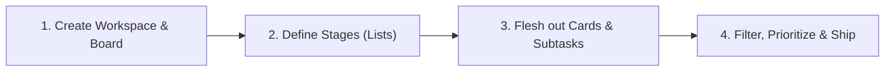

# Plana

> **Simple project management. Clear workflows. Fast execution.**

Plana is a modern, visual Kanban workspace built for teams and individuals who want to move from idea to delivery without the friction of bloated project management software.

---

## Why Plana? (The "So What")

Most modern project management tools have become cumbersome—cluttered with overwhelming configuration menus, complicated Gantt charts, and feature bloat that slows teams down.

**Plana strips away the noise:**
- **Zero-friction execution:** Start managing tasks immediately without needing a training manual.
- **Instant visual clarity:** Understand project status, bottlenecks, and ownership in a single glance.
- **Deep focus:** Filter down to what's urgent today without losing the broader context of your pipeline.
- **Radical transparency:** Built-in activity trails keep everyone aligned and accountable.

---

## Core Capabilities

```
Organization  ───►  Board  ───►  List  ───►  Card
 (Workspace)       (Project)    (Stage)     (Task)
```

### 1. Intuitive Kanban Workflows
- **Fluid Drag-and-Drop:** Move cards vertically within stages and horizontally across your pipeline with instant, tactile feedback.
- **Ready-to-Use Templates:** Spin up boards instantly using curated templates (such as *Software Development* or *Personal Sprint*) or start fresh with a blank canvas.
- **Visual Board Themes:** Personalize your team's visual workspace with curated backdrops and high-resolution imagery.

### 2. High-Impact Task Management (Cards)
Every task in Plana is designed for depth without clutter:
- **Interactive Checklists & Subtasks:** Break complex tasks into bite-sized steps with live completion tracking (`X of Y completed` with an automated progress bar).
- **Priority Indicators:** Categorize urgency at a glance (`Low`, `Medium`, `High`, `Urgent`).
- **Due Dates & Overdue Alerts:** Keep milestones on track with clear date markers and deadline status indicators.
- **Color-Coded Labels:** Tag items with custom color categories for effortless visual taxonomy.
- **Team Assignees:** Assign specific workspace members to tasks with one-click assignment controls.
- **Rich Task Descriptions:** Capture requirements, context, and documentation directly on the card.

### 3. Real-Time Board Filtering & Focal Mode
Never get lost in a busy board. Filter any board on the fly:
- **Instant Search:** Find any task across all lists by typing keywords.
- **Priority Filtering:** Isolate urgent blockers or low-priority backlogs in one click.
- **Deadline Filtering:** Focus exclusively on upcoming deadlines or overdue tasks.
- *Preserves Layout:* Filtering refines what you see while preserving your list structures and workflow integrity.

### 4. Workspaces & Team Workload
- **Multi-Tenant Organizations:** Keep work organized into dedicated workspaces for distinct teams, departments, or client projects.
- **Workload & Member Visibility:** View active workspace members and plan capacity with clear insight into team assignments.

### 5. Complete Activity & Audit Trail
- **Card-Level History:** See every update, checklist change, and milestone logged in chronological order.
- **Workspace Activity Stream:** Track organizational momentum across all boards, lists, and cards so nothing falls through the cracks.

---

## The Workflow in Action



1. **Set the Stage:** Create an organization workspace and launch a board tailored to your project.
2. **Define the Pipeline:** Organize your workflow into natural milestones (e.g., *Backlog*, *In Progress*, *Review*, *Done*).
3. **Detail the Work:** Create cards, break them down with checklists, tag priorities, and assign owners.
4. **Execute & Deliver:** Drag work across stages as progress happens, filter for daily priorities, and celebrate shipped milestones.

---

## Product Philosophy

- **Clarity Over Complexity:** Every feature must directly serve the goal of completing work faster.
- **Speed as a Core Feature:** Fast load times, responsive drag interactions, and instant updates.
- **Accountability by Default:** Transparent activity trails ensure everyone knows who owns what and when it happened.
